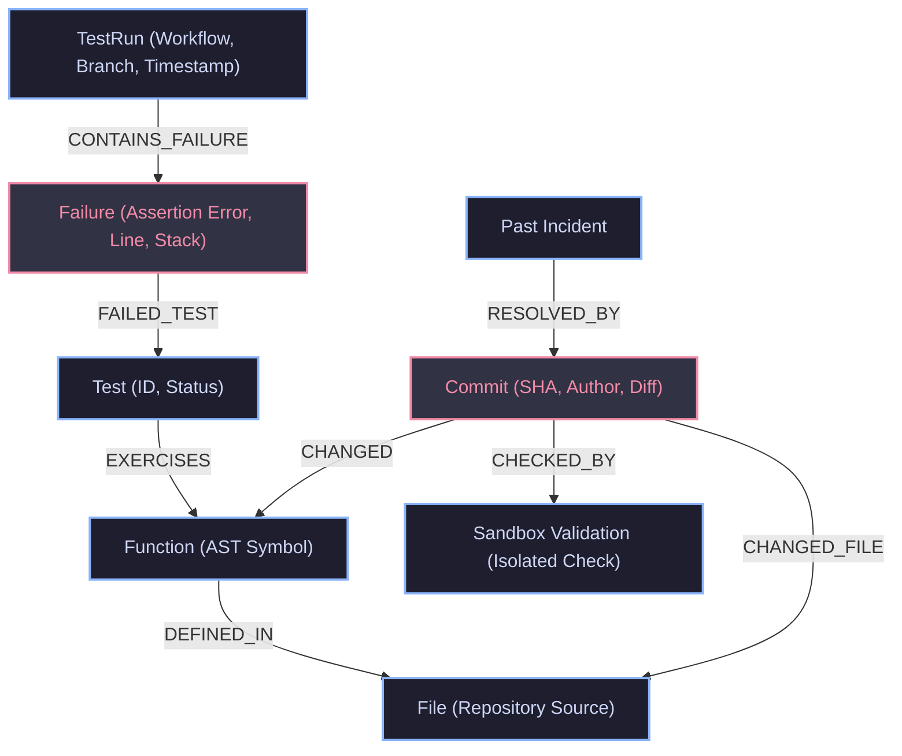
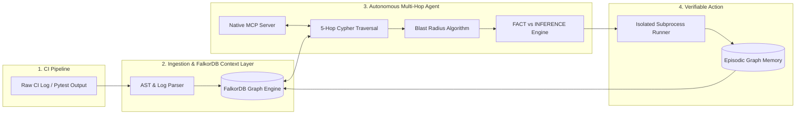

# Why Flat CI Logs Fail AI Agents — And How We Built RootCause AI Using FalkorDB

*By Ankush Kumar & The RootCause AI Team*  
*Built for Graph Hacks 2026 (WeMakeDevs & FalkorDB) — Track 01: Agents That Act on Connected Data*

---

## The 2:00 AM Developer Nightmare

Every software engineer knows this feeling: it's late, you push a critical pull request, and 4 minutes later, the CI pipeline turns red. 

You click on the GitHub Actions tab, and you're greeted with **4,800 lines of raw terminal logs**. Somewhere between hundreds of passing unit tests and environment setup logs sits an unhelpful one-liner:

```text
FAILED tests/test_checkout.py::test_checkout_rejects_expired_coupon - AssertionError: Expected expired coupon to be rejected; got accepted
```

Now the manual detective work begins:
* *Which exact function in our codebase does this test execute?*
* *Which source file does that function live in?*
* *Who changed that function in the last 48 hours, and which git commit introduced the bug?*
* *What is the blast radius across other downstream services?*

If you feed this flat log into a traditional LLM or a Vector Database (RAG), it frequently hallucinates. Why? **Because flat text doesn't preserve structural relationships.** A vector embedding knows that "coupon" is semantically related to "discount", but it has zero understanding of the directional graph connection between an AST function symbol, a unit test assertion, and a git commit SHA.

To solve this, we built **RootCause AI**—an autonomous regression triage agent powered by **FalkorDB** as its operational context and memory brain.

---

## The Paradigm Shift: The Graph *IS* the Agent's Context

From day one, our primary design principle was aligned with Rule 3 of Graph Hacks: **FalkorDB could not be a cosmetic decoration.** If you take FalkorDB out of RootCause AI, the agent stops working entirely.

We modeled software engineering reality into a directional knowledge graph:



In FalkorDB, every hop is a pointer traversal running in sub-milliseconds over Redis-protocol storage. Instead of running 6 heavy SQL `JOIN`s or guessing with embeddings, our agent executes a multi-hop OpenCypher query:

```cypher
MATCH (failure:Failure {id: $failure_id})-[:FAILED_TEST]->(test:Test)
      -[:EXERCISES]->(fn:Function)-[:DEFINED_IN]->(file:File)
OPTIONAL MATCH (commit:Commit)-[:CHANGED]->(fn)
RETURN failure.message, test.id, fn.name, file.path, 
       commit.sha, commit.author, commit.at
ORDER BY commit.at DESC
```

In a single query, the agent connects the dots from the red assertion error directly to commit `a17c9e2` authored by Mina Patel, which modified `validate_coupon()` just 44 minutes before the pipeline broke.

---

## What We Built During Graph Hacks



### 1. Ingesting Raw CI/CD Logs on the Fly
We didn't want a static demo with one hardcoded test. We engineered a flexible regex and AST parser (`app/parser.py`) capable of parsing real GitHub Actions console output, Pytest verbose runs, and Python tracebacks. 

With one click, our ingestion engine (`app/ingester.py`) merges the run metadata, failing assertions, file paths, line numbers, and git commits directly into FalkorDB using OpenCypher `MERGE` statements.

### 2. Transparent Explainability: FACT vs INFERENCE
One of the biggest flaws with existing AI agents is that they present assumptions as facts. RootCause AI implements an explicit evidence trail:
* **`FACT`**: Any relationship recorded directly in the FalkorDB graph (e.g., *"`test_checkout_rejects_expired_coupon` exercises `validate_coupon()` at `src/checkout.py:38`"*).
* **`INFERENCE`**: The agent’s reasoned hypothesis (e.g., *"`a17c9e2` is the leading candidate because it altered the comparison operator shortly before the CI run"*).

### 3. Blast Radius Graph Algorithm
To understand the downstream ripple effects of a regression, our agent executes a graph algorithm (`analyze_blast_radius`):

```cypher
MATCH (fn:Function {name: $fn_name})
OPTIONAL MATCH (t:Test)-[:EXERCISES]->(fn)
OPTIONAL MATCH (fn)-[:DEFINED_IN]->(f:File)<-[:DEFINED_IN]-(sibling_fn:Function)
OPTIONAL MATCH (sibling_test:Test)-[:EXERCISES]->(sibling_fn)
RETURN fn.name, 
       collect(DISTINCT t.id) AS direct_tests, 
       collect(DISTINCT sibling_test.id) AS indirect_tests
```

It calculates a **Connectivity Risk Score** and flags whether changing this function risks breaking other sibling tests or services in the repository.

### 4. Taking Action: Isolated Subprocess Sandbox
Official Track 01 asks for *"Agents That Act on Connected Data"*. RootCause AI doesn't stop at explaining—it takes action. 

Once a candidate cause is ranked, the agent spins up a safe, temporary directory (`tempfile`) and runs an isolated Python subprocess check (`app/validation.py`) testing the fix against a regression fixture. If the test passes (`PASSED ✓`), the result is written back to FalkorDB as a `(:Validation)` node linked to the candidate commit.

### 5. Native MCP (Model Context Protocol) Server
To make our tools usable across the entire developer ecosystem, we implemented a native MCP server (`app/mcp_server.py`). Any developer using **Claude Desktop**, **Cursor IDE**, or **Antigravity IDE** can connect to RootCause AI over standard JSON-RPC:

```json
{
  "mcpServers": {
    "rootcause-ai": {
      "command": "python3",
      "args": ["-m", "app.mcp_server"],
      "cwd": "/path/to/GRAPHAGENT"
    }
  }
}
```

Now, external LLMs can invoke `trace_failure_path`, `analyze_blast_radius`, and `validate_candidate_fix` as native tools!

---

## Key Learnings & Takeaways

Building RootCause AI over the course of Graph Hacks was an eye-opening engineering journey. Here are our 3 biggest takeaways:

1. **Graphs outperform Vectors for Causal Reasoning:** Vector search is great for fuzzy document search, but software engineering is deterministic. Functions have callers; files have commits; tests have dependencies. Graph pointers are the only reliable way to model causality without hallucinations.
2. **FalkorDB's Speed Changes Agent Loops:** Because FalkorDB evaluates Cypher queries in sub-milliseconds on Redis internals, our agent can query the graph multiple times in a single loop—traversing paths, checking past incident memories, and calculating blast radius—without adding latency.
3. **Sandbox Validation is the Missing Link in AI Coding:** An agent that only suggests code isn't complete. An agent that queries connected context, forms a hypothesis, and independently validates it in a sandboxed test runner provides true developer leverage.

---

## Try It Out & Get Involved

RootCause AI is completely open-source under the MIT License:

* **GitHub Repository:** [github.com/ankushkumar14092-dot/rootcauseai](https://github.com/ankushkumar14092-dot/rootcauseai)
* **Local Setup in 1 Command:**
  ```bash
  docker compose up --build
  ```
  Open `http://localhost:8000` to triage regressions, and explore the live graph at `http://localhost:3000` in the FalkorDB Browser.

A huge thank you to **WeMakeDevs** and the **FalkorDB** team for hosting Graph Hacks 2026. Context is everything for AI agents—and graphs are the future of that context.
